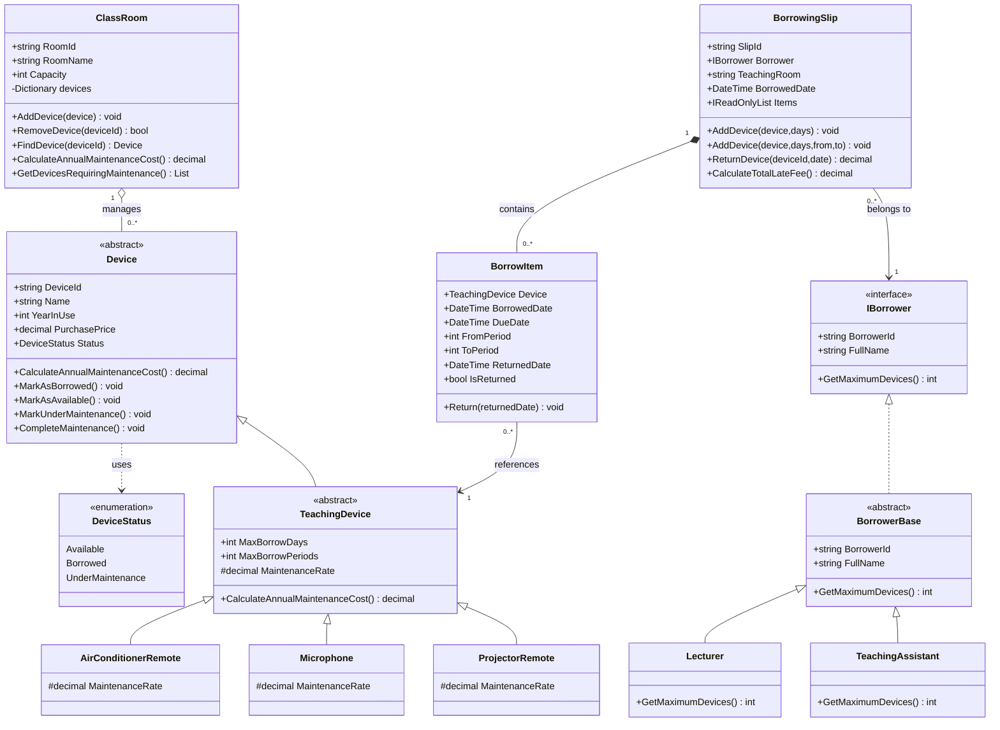
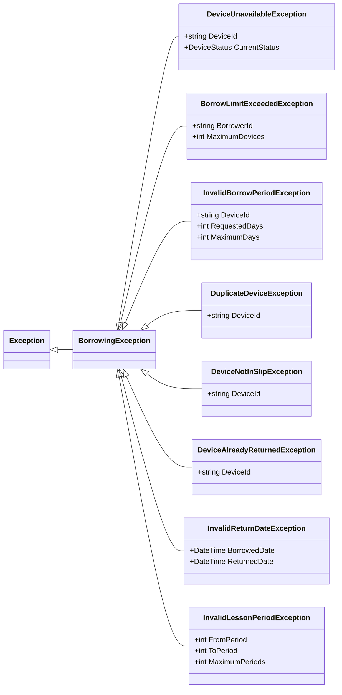

# UML Class Diagram — Lab W06

Sơ đồ lớp được thiết kế từ chương trình C# Lab W06, gồm hai phần: nghiệp vụ và ngoại lệ. `Program.cs` là lớp giao diện Console quản lý các đối tượng qua `Dictionary`; để sơ đồ dễ đọc, các thao tác nhập/xuất và menu không liệt kê trong biểu đồ nghiệp vụ.

## 1. Sơ đồ lớp nghiệp vụ

## 2. Hệ phân cấp ngoại lệ

## 3. Ký hiệu UML

- `--|>`: kế thừa lớp.
- `..|>`: thực thi interface.
- `o--`: kết tập. Phòng học chứa tham chiếu đến các thiết bị, không sở hữu vòng đời của chúng.
- `*--`: hợp thành. Phiếu mượn chứa các BorrowItem.
- `-->`: liên kết/tham chiếu giữa hai lớp.
- `..>`: phụ thuộc (ví dụ Device dùng enum DeviceStatus).

**Chú ý:** Trong code hiện tại, `BorrowingSlip.TeachingRoom` chỉ lưu **mã phòng dạng `string`**, chưa phải tham chiếu tới đối tượng `ClassRoom`. Không nên vẽ quan hệ trực tiếp tới `ClassRoom` như thể đã có thuộc tính đó.
